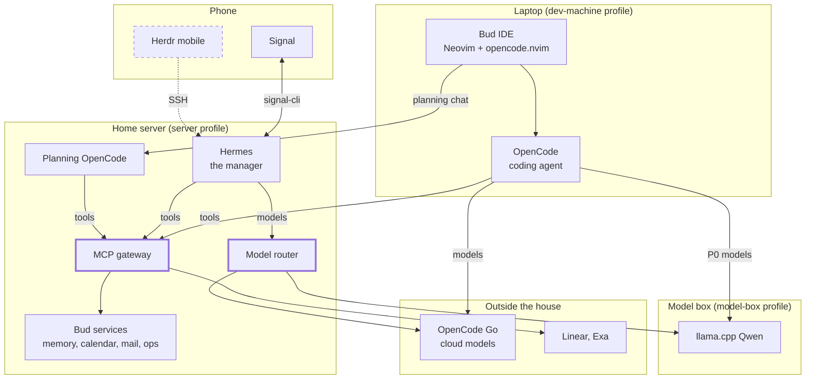
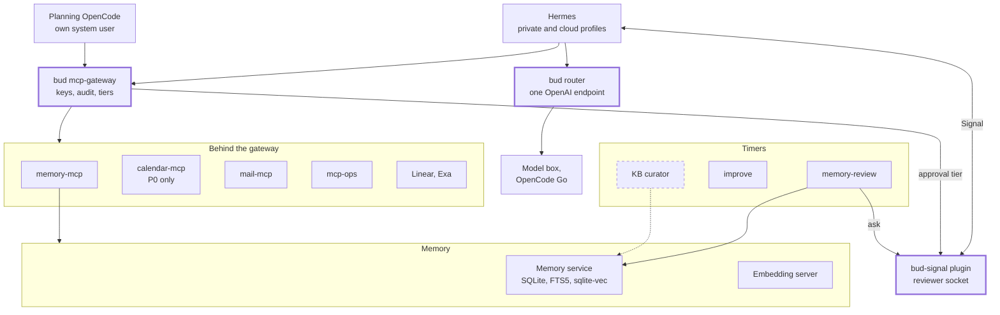
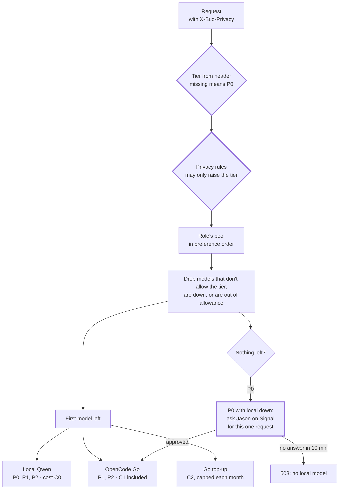
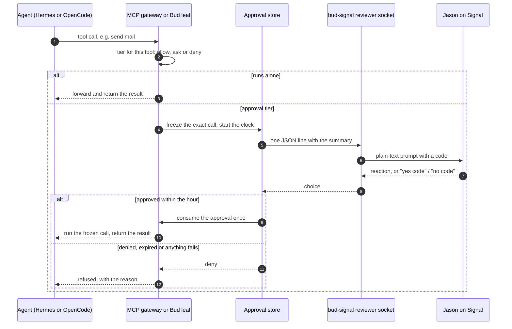
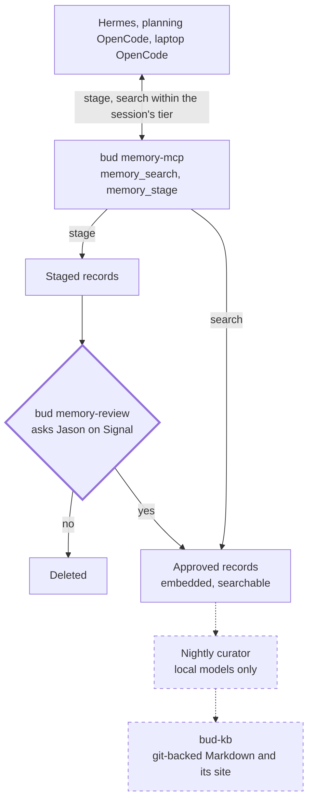
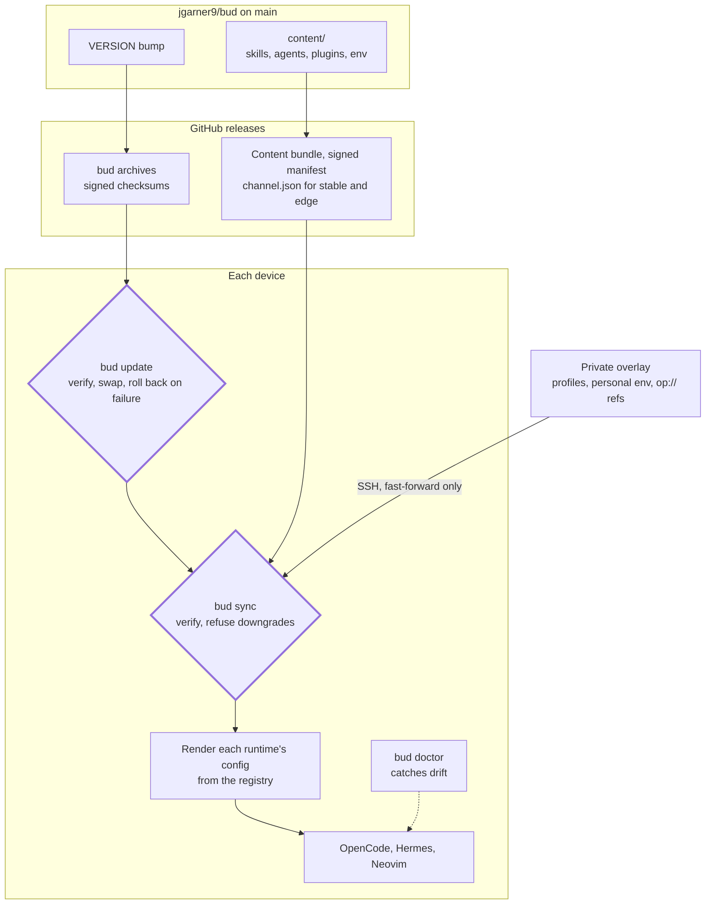

# Architecture

Bud is a set of small parts spread over a few machines: an editor and coding agent on the laptop, a manager and its services on an always-on home server, a model box that serves local models, and signed releases that keep them all in step. This page draws that system at six levels, from the whole suite down to single flows, so you can see where a piece lives and what it talks to before reading its code. Each diagram is followed by what it shows and why it's built that way.

"Suite Dn" refers to the Bud Suite decision log, and the [internals docs](https://github.com/jgarner9/bud/tree/main/docs/internals) explain each part in detail.

## How to read the diagrams

| Mark | Meaning |
| --- | --- |
| Solid box and line | Built and running |
| Dashed box or line | Planned, not built yet |
| Box with a thick border | A place where Bud decides something: a privacy tier, an approval, a signature |
| `P0`, `P1`, `P2` | Privacy tiers: private, internal, public |

Machines are named by role (laptop, home server, model box), never by hostname. Real names and addresses live in the private overlay.

## 1. The suite

**What it shows.** Every runtime Bud runs and the machine it runs on. The laptop is where code gets written: the Bud IDE drives a local OpenCode. The home server is on all the time and runs Hermes, the 24/7 manager (Suite D48), a second OpenCode for planning chats (Suite D49), and the Bud services. The model box only serves local models and calls out to nothing. Jason reaches the manager from a phone over Signal.

**Why.** Keys and personal data stay on the home server, so a laptop holds no MCP keys and reaches Linear and Exa only through the gateway (Suite D72). Local models sit on their own box because they need the GPU, and that box sleeps, which is why the router can fall back when it's down (Suite D104). One `bud` binary does every job on every machine; a device profile says which parts that machine runs (Suite D22, D56).

## 2. The home server

**What it shows.** What runs on the home server and who calls whom. The two runtimes, Hermes and the planning OpenCode, reach tools only through the MCP gateway and models through the router. Bud's own MCP servers (memory, calendar, mail, ops) are upstreams behind the gateway and listen on loopback only. The timers, `bud memory-review` and `bud improve`, run on their own and never talk to an agent.

**Why.** The gateway is the single place that holds keys (from `op run`, Suite D7), writes the audit log and applies the privacy tier to every tool call (Suite D81, D112), so no runtime or upstream has to be trusted to do it. Bud owns these leaves, so it can enforce approvals there; it ships no patched Hermes or OpenCode (Suite D97). The reviewer socket in the bud-signal plugin is the one place approvals are answered, which keeps the decision channel out of any agent's reach (Suite D101, D103).

## 3. Routing and privacy

**What it shows.** How `bud router` picks a model for one request. The tier comes from the `X-Bud-Privacy` header, and a request without one is P0, so a client that isn't set up fails closed (Suite D23, D81). Privacy rules, such as a message starting with `#private`, can raise the tier but never lower it (Suite D112). The role's pool is then filtered by tier, provider health and allowance, and the first model left serves it.

**Why.** P0 text should never leave the house by accident, so only local models allow P0. When the model box is asleep, a P0 request is held while Jason is asked on Signal to send that one request to a cloud model, and is refused if there is no answer (Suite D104, D105). Cost is tiered too: local first, then the Go plan's included allowance, then a top-up capped at about $10 a month (Suite D11). The header is a guard against leaks, not authentication; the tailnet is the authentication (Suite D100).

## 4. Approvals

**What it shows.** The path of an action that needs Jason's say-so, such as sending an email or merging. Actions fall into three tiers: do alone (reads, drafts, texts to Jason), approve by phone (sends, pushes to main, spending, infrastructure, secrets), and never (Suite D10, D16). Approval-tier calls are frozen exactly as they'll run, shown to Jason on Signal, and run only after a yes.

**Why.** Bud enforces approvals only at leaves it owns, because a stock runtime can rewrite a call after its own hooks (Suite D97). Every failure denies: an unanswered prompt expires after an hour, and a session with nobody to answer refuses approval-tier actions instead of waiting forever (Suite D99, D111). Each approval covers one named call and is spent when used, so it can't be replayed.

## 5. Memory and the knowledge base

**What it shows.** Two layers of memory (Suite D9, D13). Working memory is a SQLite store behind `bud memory-mcp`: agents stage what they want remembered, and nothing becomes searchable until Jason approves it on Signal (Suite D51, D113). Search ranks by text and vectors together and only returns records within the session's privacy tier. A planned nightly curator will promote lasting facts into bud-kb, a private Git repository of Markdown pages with its own site.

**Why.** Every runtime shares the same memory, so none keeps a store of its own and the laptop and the manager know the same things (Suite D102). Staging keeps an agent from writing something wrong or private into memory for good. The curator uses local models only, and keeps P0 facts out of the KB while its remote is GitHub (Suite D123).

## 6. Releases, devices and sync

**What it shows.** How code and content reach a device. Code and content are released separately: a `VERSION` bump on main cuts a signed binary release (D80), and a change under `content/` cuts a signed content bundle (Suite D57). `channel.json` says which version each channel offers; the laptop follows edge and the home server stable. `bud sync` layers the private overlay over the public content and renders every runtime's config from one model registry (Suite D46, D58).

**Why.** A device refuses anything unsigned and any version older than the one it has, so an old signed bundle can't roll it back; going back is an explicit `bud sync --rollback` (Suite D60). The overlay is unsigned but comes over SSH from a private repository Jason controls (Suite D59). Rendering from one registry means swapping a model for a role is one edit, and `bud doctor` catches a config that drifted.

## Keeping these diagrams current

The diagrams are [Mermaid](https://mermaid.js.org) in this Markdown file, so there is one source: GitHub draws them when you view the file, and the docs site draws them in the browser. To change one, edit its code block and check it in the [Mermaid live editor](https://mermaid.live) or on GitHub's preview.

- Update the diagram in the same change as the code that alters what it shows.
- A new architecture level gets its own numbered section with a diagram, then "What it shows" and "Why", and cites the decisions behind it.
- Use the marks in the table above: `classDef planned stroke-dasharray: 5 5` for planned parts, `classDef gate stroke-width:3px` for decision points. Leave colours to the theme so the diagrams read in light and dark.
- Name machines by role, never by hostname or address, since `just leak-check` and the public repo forbid personal details.
